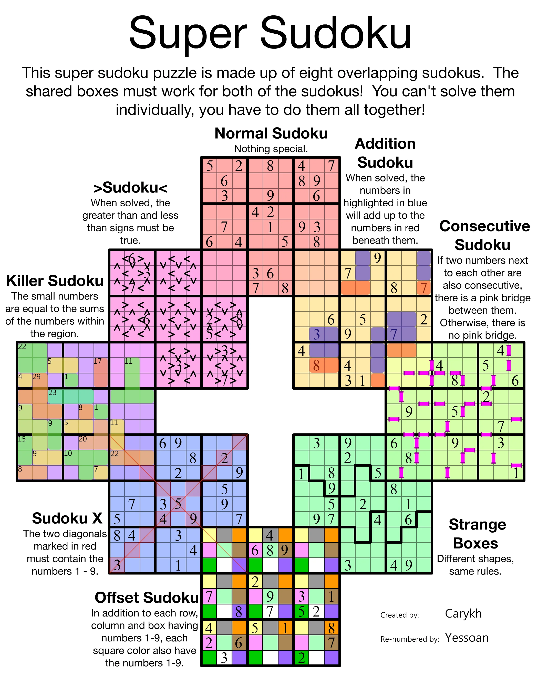

# SuperSudoku Generator

App locale per generare e risolvere supersudoku da PC e telefono: otto varianti, 576 celle, sovrapposizioni e soluzione unica verificata.

[English documentation (main)](README.md)

## Ispirazione e crediti

Questo progetto nasce dall'ispirazione del **Super Sudoku** mostrato qui sotto: otto sudoku sovrapposti che combinano regole diverse. L'immagine attribuisce la creazione a **Carykh** e la rinumerazione del rompicapo a **Yessoan**. Grazie a entrambi per il sudoku da cui è nata l'idea di questa app.

L'immagine è inclusa come riferimento al loro lavoro, con i crediti originali. Il codice di questo progetto genera nuovi rompicapi, con composizioni configurabili e tipi ripetuti. Il rompicapo della foto non è la partita iniziale dell'app: questa è un'implementazione indipendente.

<details>
<summary>Mostra il sudoku di riferimento — creato da Carykh, rinumerato da Yessoan</summary>



</details>

## Prima partita

Richiede Node.js 22 o successivo. Dal terminale aperto nella cartella Supersudoku:

```powershell
node server.js
```

Apri **http://localhost:5173**. Non occorre installare dipendenze per giocare. Mantieni aperto il terminale; Ctrl+C arresta il server.

La prima partita è già pronta e verificata. **Nuova partita** permette di scegliere Facile, Media o Difficile, la composizione degli otto sudoku e un codice facoltativo. I tipi possono ripetersi: il totale delle quantità deve essere 8. Le posizioni vengono mescolate e le copie dello stesso tipo hanno un numero distinto.

Dal telefono, collegati allo stesso Wi-Fi del PC e apri uno degli indirizzi `Phone (same Wi-Fi)` stampati nel terminale. Il PC e il server devono rimanere accesi. Se Windows chiede l'accesso alla rete per Node, consenti la rete privata per usare il telefono. Il progetto non è pubblicato online.

**L'uso dal telefono senza PC o terminale non è ancora pubblicato.** Il prossimo passo è l'hosting HTTPS e la verifica dell'installazione PWA su un telefono reale. L'attuale indirizzo di rete locale richiede ancora il server indicato sopra.

## Comandi

- Seleziona una cella e usa il tastierino o la tastiera. Le frecce spostano la selezione.
- **Ingrandisci sudoku** mostra una griglia e isola i suoi indizi, evitando confusione tra gabbie di tipi ripetuti; tocca un nome nell'elenco per cambiarla. **Schema completo** mostra tutte le sovrapposizioni. I controlli + e − aumentano lo zoom; scorri la griglia per spostarti.
- Ogni sudoku ha nome e pulsante **Regole**, nello schema completo e nell'elenco. Una cella condivisa ha un solo valore e rispetta entrambi i sudoku.
- **Appunti** (N), **Cancella** (Backspace/Delete), **Annulla** (Ctrl/Cmd+Z), **Ripristina** (Ctrl/Cmd+Shift+Z).
- Il controllo predefinito confronta con la soluzione; puoi scegliere solo le violazioni delle regole o disattivarlo. Gli errori vengono mantenuti ed evidenziati per consentire correzione o annullamento.
- I progressi si salvano automaticamente nello stesso browser: numeri, appunti e tempo. La cronologia di annulla/ripristina vale per la sessione aperta. Nessuna sincronizzazione tra dispositivi.
- **Mostra soluzione** non sovrascrive la partita; ripremilo per tornare a giocare. **Ricomincia** cancella i progressi dopo conferma.
- Italiano / English cambia tutti i testi senza modificare la partita e conserva la preferenza.
- **Stampa** usa lo schema completo. Manifest e service worker permettono installazione e offline nei browser compatibili su localhost o HTTPS, dopo il primo caricamento. Sul telefono tramite indirizzo HTTP del PC si può giocare, ma installazione e offline non sono disponibili.

## Generazione

I tipi disponibili sono Classico, Disuguaglianze, Somme, Killer, Consecutivi, X, Regioni irregolari e Offset. Puoi scegliere qualsiasi composizione di otto sudoku, anche otto dello stesso tipo. Le posizioni vengono mescolate mantenendo 72 celle condivise. Ogni copia ha indizi indipendenti.

Il generatore costruisce una soluzione per la disposizione, crea regioni irregolari connesse e indizi, quindi rimuove numeri solo verificando che la soluzione rimanga unica. Anche i ponti mancanti nel sudoku consecutivo sono vincoli. Nel sudoku somme, due celle blu sommano alla cella arancione sotto; le lettere identificano i gruppi. Le gabbie Killer non consentono ripetizioni.

La generazione usa un Web Worker per lasciare reattiva l'interfaccia. Puoi annullarla senza perdere la partita. La ricerca ha limiti di calcolo: in caso di fallimento puoi riprovare, conservando lo schema attuale. Lo stesso codice riproduce la partita nella stessa versione del generatore.

L'immagine di riferimento è inclusa nella documentazione della repository e non viene servita dal gioco. Il generatore crea nuovi indizi e regioni, senza trascrivere la foto.

## Verifica e sviluppo

```powershell
node --test
node scripts/check.js
```

Per i test nel browser, dipendenze, cache e browser restano nel progetto:

```powershell
npm.cmd ci --cache .cache/npm
$env:PLAYWRIGHT_BROWSERS_PATH = Join-Path (Get-Location) '.cache/browsers'
node node_modules/playwright/cli.js install chromium
npm.cmd run test:e2e
```

Playwright verifica desktop e telefono simulato: inserimento, errori, cambio lingua, salvataggio, nuova partita, completamento e offline. La simulazione usa Chromium e non sostituisce una prova su Safari/iOS reale. I test avviano e arrestano il loro server sulla porta 5173: ferma il server di gioco prima di eseguirli.

`node scripts/create-starter.js` rigenera la prima partita in `data/starter.json`. `src/i18n.js` centralizza i testi visibili in entrambe le lingue; gli errori tecnici del motore sono diagnostica interna.

Non sono ancora implementati suggerimenti logici. Il salvataggio richiede che il browser consenta l'archiviazione locale.

## Difficoltà

La classificazione è relativa alle tecniche implementate dal motore, non è una certificazione della difficoltà percepita da una persona:

- **Facile**: risolvibile con candidati singoli, eliminazioni dei numeri già presenti e deduzioni locali dai vincoli delle varianti.
- **Media**: richiede anche candidati unici nei gruppi di nove celle (hidden singles).
- **Difficile**: le deduzioni supportate non bastano; il risolutore deve procedere con ricerca. Un essere umano potrebbe usare altre tecniche logiche non implementate.

Il generatore verifica il livello richiesto e l'unicità: il livello non dipende soltanto dal numero di celle vuote. Alcune combinazioni di varianti e codice possono non produrre il livello richiesto entro i limiti di ricerca. In questo caso l'app lo segnala e mantiene la partita precedente, senza abbassare silenziosamente il livello.

Per riprodurre una partita usa lo stesso codice, la stessa composizione, la stessa difficoltà e la stessa versione del generatore. Le partite già salvate restano compatibili.
