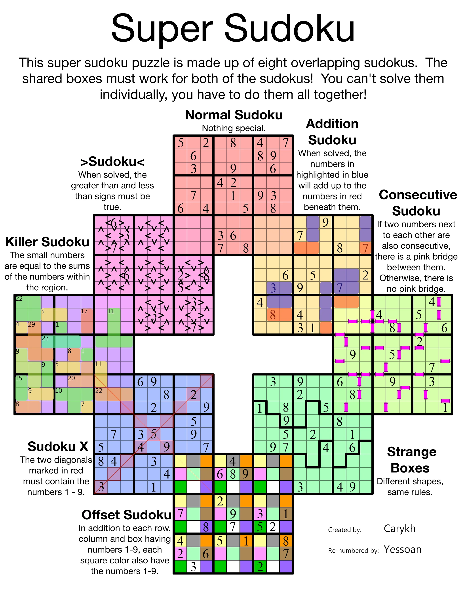

# SuperSudoku Generator

A local app to generate and play supersudokus on computers and phones: eight variants, 576 cells, shared overlaps and verified unique solutions.

English is the primary language for this repository, documentation, commits and pull requests. [Documentazione italiana](README.it.md) is available as a secondary translation. The game itself supports both Italian and English.

## Inspiration and credits

This project was inspired by the **Super Sudoku** puzzle shown below: eight overlapping sudokus combining different rule sets. The reference image credits **Carykh** as the creator and **Yessoan** for re-numbering the puzzle. Thank you to both for the puzzle that inspired this app.

The image is included as an attributed reference to their work. This project's code generates fresh puzzles, with configurable variant mixes and repeated types. The reference puzzle itself is not the app's starting game, and this project is an independent implementation.

<details>
<summary>View the inspiration puzzle — created by Carykh, re-numbered by Yessoan</summary>



</details>

[Community post sharing the re-numbered Super Sudoku](https://www.reddit.com/r/tenwordsofwisdom/comments/4xckvp/our_local_twower_yessoan_fixed_carys_super_sudoku/).

## First game

Requires Node.js 22 or later. In a terminal opened in Supersudoku:

```powershell
node server.js
```

Open **http://localhost:5173**. No dependencies need installing to play. Keep the terminal open; Ctrl+C stops the server.

A verified first game is ready immediately. **New game** lets you choose Easy, Medium or Hard, a custom eight-board mix, and an optional game code. Types can repeat: board counts must total 8. Positions are shuffled, and repeated types receive distinct instance numbers.

On a phone, join the same Wi-Fi as the computer and open one of the `Phone (same Wi-Fi)` addresses printed in the terminal. Keep the computer and server on. If Windows requests network access for Node, allow the private network to connect from your phone. The project is not published online.

**Phone use without the computer or terminal is not deployed yet.** The next step is HTTPS hosting and verification of PWA installation on a real phone. The current local-network address still requires the server above.

## Controls

- Select a cell and use the number pad or keyboard. Arrow keys move the selection.
- **Focus on sudoku** enlarges a board and isolates its clue markings, so overlapping cages from repeated types stay readable; tap names in the list to switch. **Full puzzle** shows all overlaps. Use + and − for additional zoom; scroll the board to move around.
- Every board has a name and **Rules** button beside the full puzzle and in the list. Shared cells have one value and follow both boards' rules.
- **Notes** (N), **Erase** (Backspace/Delete), **Undo** (Ctrl/Cmd+Z), **Redo** (Ctrl/Cmd+Shift+Z).
- Checking defaults to comparison with the solution. Choose rule violations only, or turn checking off. Incorrect numbers are kept and highlighted for correction or undo.
- Entries, notes and time save automatically in this browser. Undo/redo history lasts for the current open session. Devices do not synchronize.
- **Show solution** does not overwrite your game; press again to return. **Restart** clears progress after confirmation.
- Italiano / English changes all text without altering the game and remembers your preference.
- **Print** uses the full puzzle. A manifest and service worker support installation and offline use in compatible browsers on localhost or HTTPS after the first load. Phones can play over the computer's HTTP address, but installation and offline support are unavailable there.

## Generation

Available types are Classic, Inequality, Addition, Killer, Consecutive, X, Irregular and Offset. Choose any mix of eight boards, including eight of the same type. Their ring positions are shuffled while preserving 72 shared cells. Each instance receives its own clues.

The generator constructs a solution for the arrangement, creates connected irregular regions and clues, then removes givens only after checking uniqueness. Missing consecutive bridges also impose constraints. In Addition Sudoku, two blue cells add up to the orange cell underneath; letters identify groups. Killer cages do not allow repetitions.

Generation uses a Web Worker to keep the interface responsive. Cancel without losing your game. Searches have computation limits: if generation fails, retry while preserving the current puzzle. Reproducing a puzzle requires the same game code, board mix, difficulty and generator version.

The reference image is included in the repository documentation; it is not served by the game. The generator creates fresh clues and regions rather than transcribing the photo.

## Checks and development

```powershell
node --test
node scripts/check.js
```

For browser tests, dependencies, caches and browsers stay inside the project:

```powershell
npm.cmd ci --cache .cache/npm
$env:PLAYWRIGHT_BROWSERS_PATH = Join-Path (Get-Location) '.cache/browsers'
node node_modules/playwright/cli.js install chromium
npm.cmd run test:e2e
```

Playwright checks desktop and a simulated phone: entry, errors, language changes, saving, generation, completion and offline use. Phone simulation uses Chromium and does not replace real Safari/iOS testing. Tests start and stop their own server on port 5173; stop your game server first.

`node scripts/create-starter.js` regenerates the first game in `data/starter.json`. `src/i18n.js` centralizes visible text in both languages; engine errors are internal developer diagnostics.

Logical hints are not implemented yet. Saving requires the browser to allow local storage.

## Difficulty selection

Difficulty is relative to the techniques implemented by the engine, not a certified rating of human solving effort:

- **Easy**: solvable using single candidates, elimination of placed digits, and local deductions from variant constraints.
- **Medium**: also requires hidden singles in nine-cell groups.
- **Hard**: supported deductions cannot finish the puzzle; the solver must search. A human may be able to use other logical techniques not implemented here.

The generator checks the requested category and uniqueness; the label is not assigned from the number of blanks alone. Some seeds and board mixes may not produce the requested category within the search limits. The app reports this and preserves the previous game rather than silently downgrading the level. This is particularly relevant for mixes with very strong variant clues.

Existing saved games remain compatible. The lower-level generation API retains the optional `blanks` argument for developer tooling; the app uses the checked `difficulty` option.

## Repository language

Use English for the main README, code identifiers, comments, commit messages, issues and pull requests. Keep user-facing application strings in both language catalogs. Italian documentation belongs in `README.it.md`.
